# ETL Olist: 9 CSVs --> Bronze --> Silver --> Gold (Medallion)

[](https://github.com/renatoapdl/pipeline-etl-vendas/actions/workflows/ci.yml)
[](https://www.python.org/)
[](https://spark.apache.org/)
[](https://spark.apache.org/)
[](https://www.databricks.com/)
[](https://airflow.apache.org/)
[](https://en.wikipedia.org/wiki/SQL)
[](https://parquet.apache.org/)
[](https://docs.pytest.org/)

## Arquitetura (Medallion)

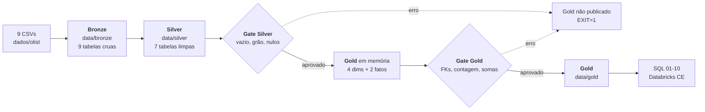

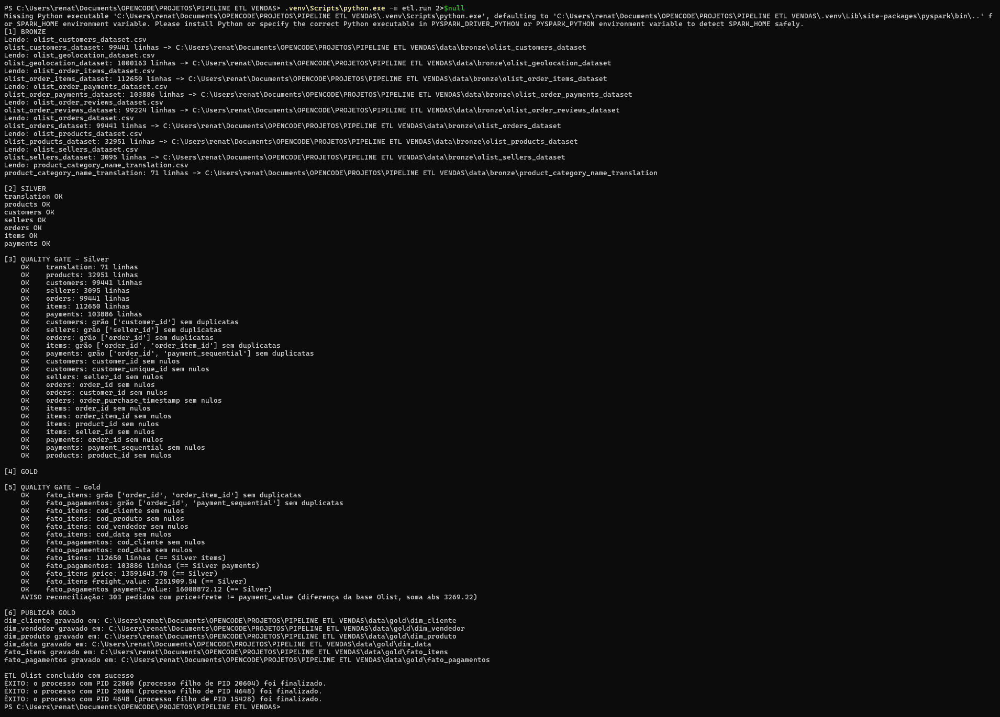

Pipeline em PySpark com arquitetura Medallion sobre o Brazilian E-Commerce Public Dataset by Olist, cerca de 100 mil pedidos feitos entre 2016 e 2018. O pipeline lê os 9 CSVs originais, preserva o dado bruto na Bronze, limpa e tipa 7 tabelas na Silver, monta um modelo estrela com 4 dimensões e 2 fatos na Gold e valida antes de publicar.

- 756 linhas de código (sem testes),
- 22 testes
- O pipeline completo roda em poucos minutos, em Spark local.

Os dados são públicos (Kaggle) e ficam em `dados/olist/`, fora do versionamento.

## Como rodar

Precisa de Python 3.9+, Java 11+ e da base Olist baixada.

1. Baixe o [Brazilian E-Commerce Public Dataset by Olist](https://www.kaggle.com/datasets/olistbr/brazilian-ecommerce) no Kaggle.
2. Extraia os 9 CSVs em `dados/olist/`, mantendo os nomes originais:

```text
olist_customers_dataset.csv
olist_geolocation_dataset.csv
olist_order_items_dataset.csv
olist_order_payments_dataset.csv
olist_order_reviews_dataset.csv
olist_orders_dataset.csv
olist_products_dataset.csv
olist_sellers_dataset.csv
product_category_name_translation.csv
```

3. Crie o ambiente e instale as dependências:

```bash
python -m venv .venv
.venv\Scripts\activate          # Windows
pip install -r requirements.txt
```

4. Rode o pipeline e os testes, a partir da raiz do repositório:

```bash
python -m etl.run               # o pipeline inteiro
python -m pytest tests -q       # os testes
```

Saída esperada (o log completo está no print acima):

```text
[1] BRONZE
Lendo: olist_customers_dataset.csv
...
[2] SILVER
translation OK
...
[3] QUALITY GATE - Silver
    OK    translation: 71 linhas
    OK    orders: grão ['order_id'] sem duplicatas
    ...
[4] GOLD
[5] QUALITY GATE - Gold
    OK    fato_itens: 112650 linhas (== Silver items)
    OK    fato_itens price: 13591643.70 (== Silver)
    AVISO reconciliação: 303 pedidos com price+frete != payment_value
[6] PUBLICAR GOLD
dim_cliente gravado em: ...
...
ETL Olist concluido com sucesso
```

### No Windows

- O PySpark precisa do Hadoop: aponte `HADOOP_HOME` para uma pasta que tenha `bin\winutils.exe`.
- O worker do Spark sobe o `python` que estiver no PATH, o que quebra se ele não tiver PySpark. Aponte `PYSPARK_PYTHON` (e `PYSPARK_DRIVER_PYTHON`) para o Python do `.venv`. Os testes fixam isso em `tests/conftest.py`.

## O que acontece

O Bronze é gravado antes de limpar: dá para conferir o que mudou comparando com o Silver, o dado original fica preservado. Os 9 CSVs são ingeridos, mas só 7 viram tabelas no Silver. `geolocation` e `order_reviews` ficam preservados na Bronze para uma versão futura.

Cada camada tem uma responsabilidade:

- `bronze.py` lê os CSVs com schema não declarado (tudo como texto) e grava o Parquet cru.
- `silver.py` aplica a limpeza e a tipagem, uma função por tabela, mantendo o grão original.
- `gold.py` monta o modelo estrela em memória (dimensões e fatos), e só grava depois do gate.
- `quality.py` recebe DataFrames já em memória, valida Silver e Gold e decide se a publicação passa.
- `load.py` grava Parquet de forma idempotente (diretório temporário + move, por causa do lock do Windows).
- `run.py` executa tudo numa sessão Spark só: Bronze, Silver, gate do Silver, Gold em memória, gate do Gold e publicação.

## Modelo estrela (Gold)

| Tabela | Grão | Colunas |
|---|---|---|
| `dim_cliente` | uma pessoa (`customer_unique_id`) | `cod_cliente`, `customer_unique_id`, `cidade`, `estado`, `cep_prefixo` |
| `dim_vendedor` | um vendedor (`seller_id`) | `cod_vendedor`, `seller_id`, `cidade`, `estado`, `cep_prefixo` |
| `dim_produto` | um produto (`product_id`) | `cod_produto`, `product_id`, `categoria_pt`, `categoria_en`, `peso_g`, `comprimento_cm`, `altura_cm`, `largura_cm`, `fotos_qty` |
| `dim_data` | um dia | `cod_data`, `data`, `ano`, `mes`, `dia`, `trimestre`, `dia_semana`, `eh_fim_de_semana`, `ano_mes` |
| `fato_itens` | um item de pedido (`order_id + order_item_id`) | `order_id`, `order_item_id`, `cod_cliente`, `cod_produto`, `cod_vendedor`, `cod_data`, `price`, `freight_value` |
| `fato_pagamentos` | uma forma de pagamento do pedido (`order_id + payment_sequential`) | `order_id`, `payment_sequential`, `cod_cliente`, `cod_data`, `payment_type`, `payment_installments`, `payment_value` |

Dois fatos porque item e pagamento têm grãos diferentes: um pedido pode ter vários itens e ser pago de várias formas. O `customer_id` não é chave de cliente: o mesmo cliente aparece em vários pedidos, e é o `customer_unique_id` que identifica a pessoa.

## O que a base Olist ensinou

1. `customer_id` não é cliente. São 99.441 `customer_id` para 96.096 `customer_unique_id`. Se a dimensão usasse `customer_id`, o mesmo comprador viraria várias linhas e a contagem de clientes sairia inflada. A `dim_cliente` usa `customer_unique_id` e guarda o endereço do pedido mais recente.
2. A `dim_data` não usa surrogate key. Ela usa `cod_data = yyyyMMdd` (inteiro), gerada do menor ao maior `order_purchase_timestamp`, num total de 774 dias. Os fatos fazem `inner join` nessa chave, então uma data fora do calendário não passa.
3. `price`, `freight_value` e `payment_value` são `decimal(12,2)`, não `double`. Somar `double` acumula erro de ponto flutuante e a reconciliação Gold × Silver não fecharia centavo a centavo.
4. No Windows, o lock de diretório do Spark exige gravar em pasta temporária e mover depois, senão o `overwrite` falha e chega a aninhar pasta. Sem `winutils.exe` o PySpark nem sobe, e o worker sobe outro Python se `PYSPARK_PYTHON` não apontar para o do `.venv`.

## Decisões que eu tomei, e o porquê

- Schema não declarado no Bronze: a correção de tipo acontece num só lugar, no Silver. Se o Spark inferisse sozinho, a mesma coluna poderia sair com tipos diferentes entre arquivos.
- Dois fatos, sem `fato_pedidos`: materializar um agregado de pedido num grão mais fino duplicaria valores. O frete fica em `fato_itens` e o `payment_value` já inclui frete.
- Chaves surrogadas por `row_number` com ordenação fixa (`customer_unique_id`, `seller_id`, `product_id`): execução determinística e idempotente.
- `left join` nas dimensões (o item não pode sumir) e `inner join` em `dim_data` (a data tem que existir no calendário).
- Reconciliação `price + frete` × `payment_value` é aviso, não erro: 303 pedidos divergem por inconsistência da própria base Olist (voucher, juros). O que bloqueia é a preservação de somas e contagens do Silver para o Gold.
- Gravação com `overwrite` via pasta temporária: rodar duas vezes não duplica linhas.
- Sem particionamento: a base tem ~100 mil pedidos e roda local; particionar não se justifica aqui.

## Arquivos

| Arquivo | Linhas | O que é |
|---|---|---|
| `etl/bronze.py` | 74 | lê os 9 CSVs crus e grava o Parquet da Bronze |
| `etl/silver.py` | 147 | limpeza e tipagem das 7 tabelas do Silver |
| `etl/gold.py` | 217 | dimensões e fatos do modelo estrela |
| `etl/quality.py` | 198 | quality gate do Silver e do Gold |
| `etl/run.py` | 53 | executa o pipeline completo numa sessão Spark |
| `etl/load.py` | 50 | gravação Parquet idempotente no Windows |
| `etl/sessao.py` | 17 | configuração da SparkSession local |
| `tests/conftest.py` | 24 | fixture do Spark para os testes |
| `tests/test_silver.py` | 168 | testes de limpeza, tipagem e grão |
| `tests/test_gold.py` | 179 | testes das dimensões, fatos e chaves |
| `tests/test_quality.py` | 164 | testes do gate (relatório, bloqueios, somas) |

## Testes

```
22 passed
```

Os testes independem dos dados: montam DataFrames pequenos em memória, então rodam no CI sem os CSVs nem os Parquets reais. Rodam a cada push e pull request na `main` pelo GitHub Actions ([`.github/workflows/ci.yml`](.github/workflows/ci.yml)): Ubuntu, Java 11 e Python 3.9. O verde da badge no topo reflete o último run.

Cobrem: normalização e tipagem do Silver, grão sem duplicatas, nulos em campos-chave, chaves surrogadas e junções do Gold, contagem e preservação de somas do Silver para o Gold, e o gate bloqueando duplicata ou contagem divergente.

## Quality gate

Antes de publicar o Gold, o `etl/quality.py` valida as duas camadas:

- Silver: as 7 tabelas não vazias, grão sem duplicatas (`order_id`, `order_id + order_item_id`, `order_id + payment_sequential`) e campos-chave sem nulos.
- Gold: grão dos dois fatos sem duplicatas, FKs (`cod_cliente`, `cod_produto`, `cod_vendedor`, `cod_data`) sem nulos, contagem igual ao Silver e somas de `price`, `freight_value` e `payment_value` preservadas.
- Aviso: a reconciliação por pedido (`price + frete` × `payment_value`) é só aviso, 303 pedidos divergem na base original.

Se houver erro, o pipeline termina com código 1 e o Gold não é publicado; Bronze e Silver ficam no disco para diagnóstico.

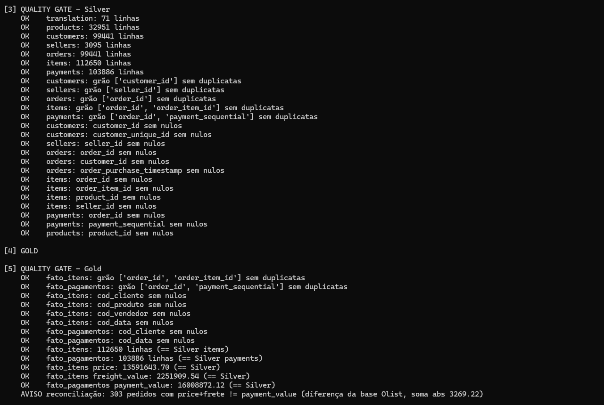

## Orquestração com Airflow

O pipeline roda no Airflow 3, num ambiente local criado com Astro CLI. A DAG é uma só, `etl_vendas`, com seis tasks na ordem `bronze >> silver >> gate_silver >> gold_gerar >> gate_gold >> publicar_gold`. Ela não fica neste repositório porque o papel dela é orquestrar: cada tarefa sobe um container `etl-vendas:3.5.3` (Python 3.9 + PySpark 3.5.3 + JDK 17) que importa este código e executa `stage.py <etapa>`.

O gate roda dentro da DAG: se o `quality.py` reprova o Silver ou o Gold, o `stage.py` termina com código 1, a publicação é interrompida e o Gold não é reescrito.

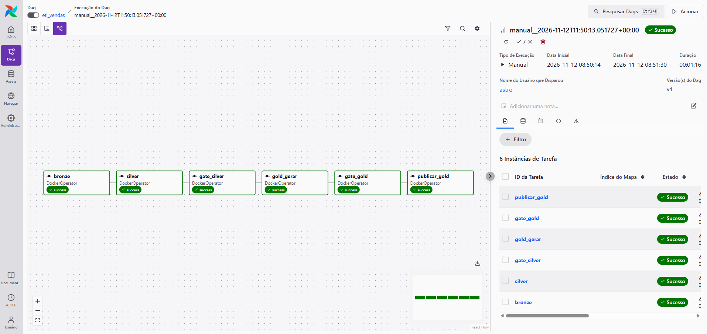

O agendamento é `schedule=None` porque a base é estática e a execução manual é o que faz sentido mostrar. Numa fonte recorrente, bastaria `schedule="@daily"` com `catchup=False`.

## O que não tem aqui

Não tem particionamento, Delta Lake no pipeline, Kubernetes, nem carga em warehouse. As tabelas `geolocation` e `order_reviews` são ingeridas na Bronze, mas ficam fora do modelo por enquanto. A orquestração com Airflow existe, mas fica no ambiente local, fora deste repositório.

O próximo passo seria particionar por data, escrever em Delta e carregar em um warehouse.

## SQL prático (Databricks CE)

Desenvolvi e validei 10 queries SQL no [Databricks Community Edition](https://community.cloud.databricks.com/) sobre os dados reais do projeto. Elas cobrem agregações, JOIN, GROUP BY, CTEs, Window Functions (`ROW_NUMBER`, `SUM() OVER`) e consultas ao modelo estrela (fato + dimensão).

As queries leem as 13 tabelas criadas a partir do Parquet do ETL: `silver.*` (camada limpa e tipada) e `gold.*` (modelo estrela). A `10_reconciliacao_gold_silver.sql` compara as somas do Gold com as do Silver e devolve diferença `0,00` nas três métricas. O passo a passo de carga está em [DATABRICKS.md](DATABRICKS.md).

Os arquivos estão em [sql/](sql/).

| Query | Arquivo | Objetivo |
|---|---|---|
| 01 | [01_receita_por_categoria.sql](sql/01_receita_por_categoria.sql) | Top 10 categorias por receita (produtos + frete), com pedidos e itens. |
| 02 | [02_receita_frete_por_estado.sql](sql/02_receita_frete_por_estado.sql) | Receita, frete e ticket médio por estado do cliente. |
| 03 | [03_top_vendedores.sql](sql/03_top_vendedores.sql) | Top 10 vendedores por receita, com preço médio do item. |
| 04 | [04_evolucao_mensal.sql](sql/04_evolucao_mensal.sql) | Evolução mês a mês usando a `dim_data`. |
| 05 | [05_ticket_medio_por_pagamento.sql](sql/05_ticket_medio_por_pagamento.sql) | Ticket médio e volume por meio de pagamento. |
| 06 | [06_distribuicao_parcelas.sql](sql/06_distribuicao_parcelas.sql) | Distribuição de parcelas (percentual de pagamentos e de valor). |
| 07 | [07_top_clientes.sql](sql/07_top_clientes.sql) | Top 10 clientes por receita, agrupando por `customer_unique_id`. |
| 08 | [08_clientes_recorrentes.sql](sql/08_clientes_recorrentes.sql) | Taxa de clientes recorrentes (2+ pedidos). |
| 09 | [09_running_total_categoria.sql](sql/09_running_total_categoria.sql) | Receita acumulada por categoria ao longo dos meses (`SUM() OVER`). |
| 10 | [10_reconciliacao_gold_silver.sql](sql/10_reconciliacao_gold_silver.sql) | Reconciliação Gold × Silver das somas (diferença `0,00`). |

### Validações no Databricks CE


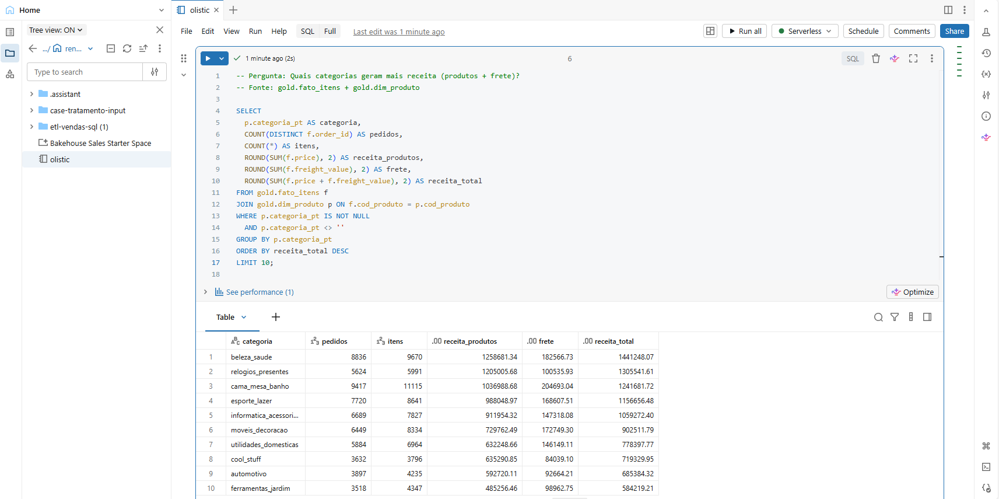

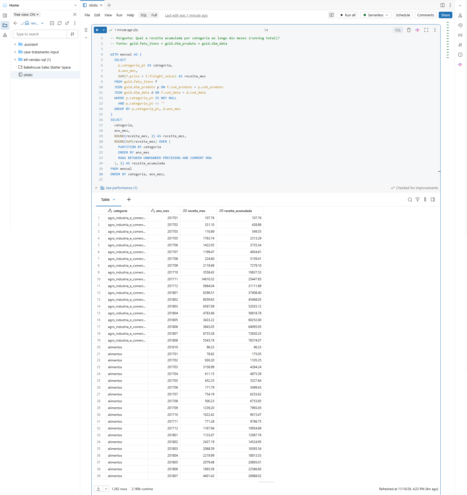

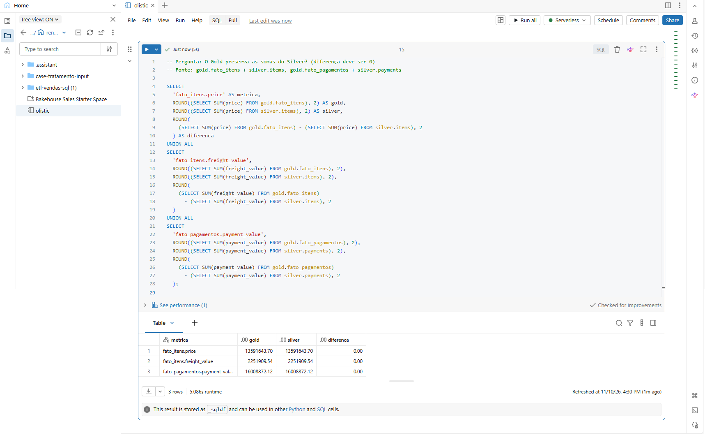

<details>
<summary>Ver os outros 7 resultados no Databricks</summary>

| Query | Print |
|---|---|
| 02 | 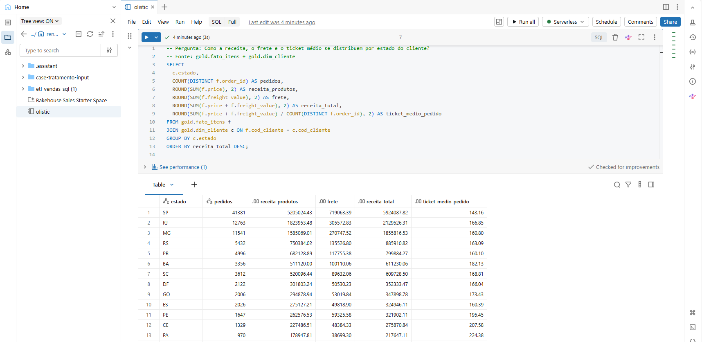 |
| 03 | 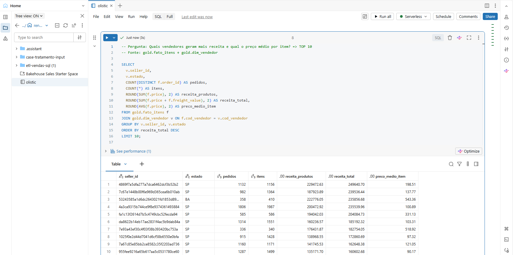 |
| 04 | 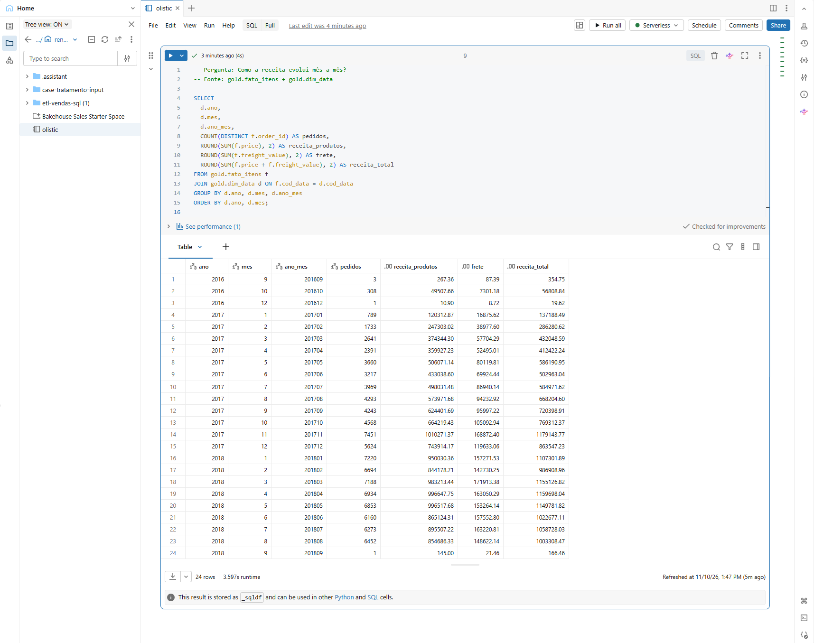 |
| 05 | 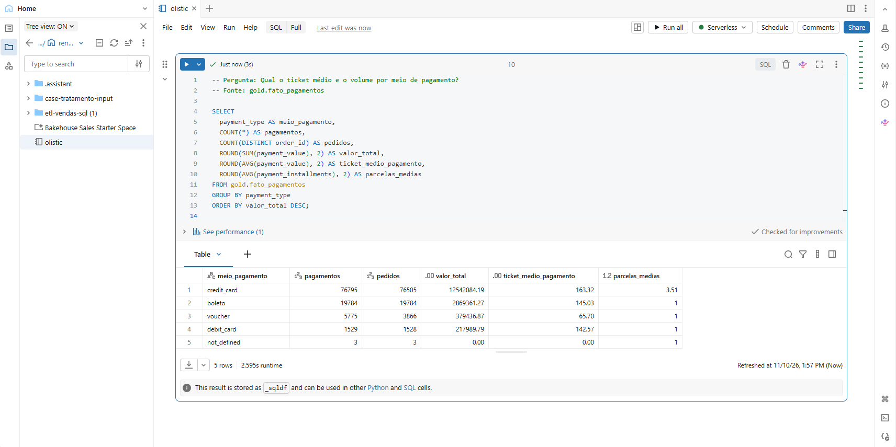 |
| 06 | 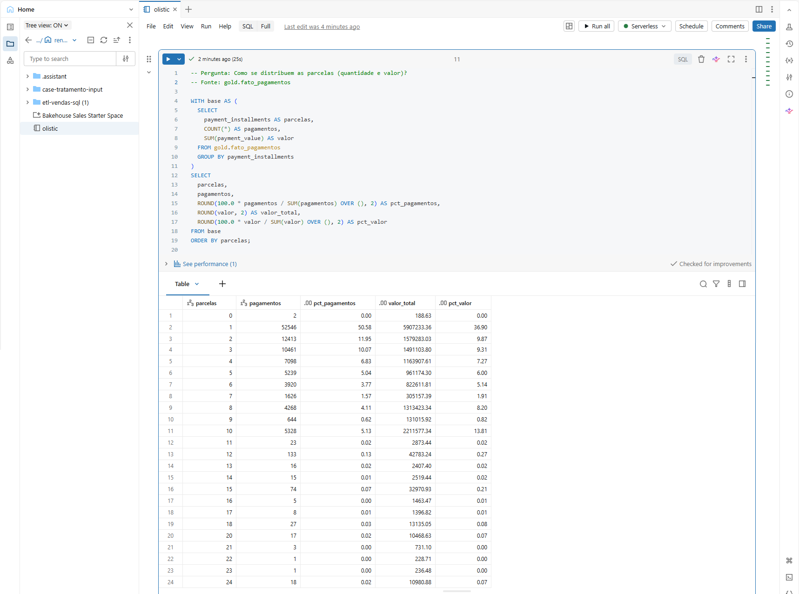 |
| 07 | 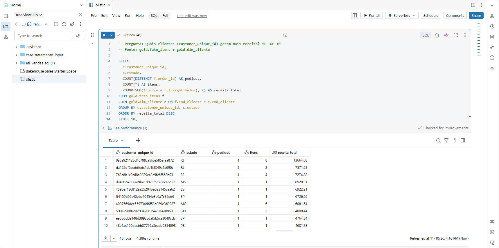 |
| 08 | 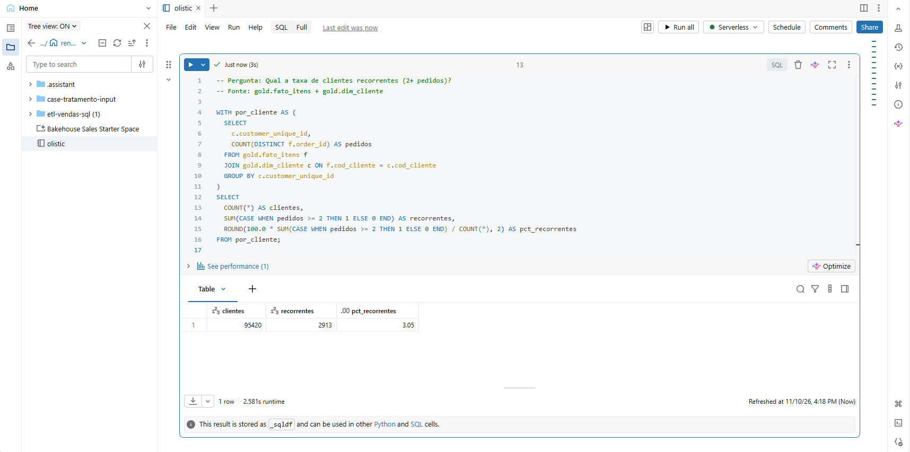 |

</details>

> Base: Parquet gerado pelo ETL (`data/silver/*` e `data/gold/*`), carregado como tabelas no Databricks.
