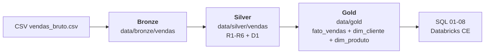
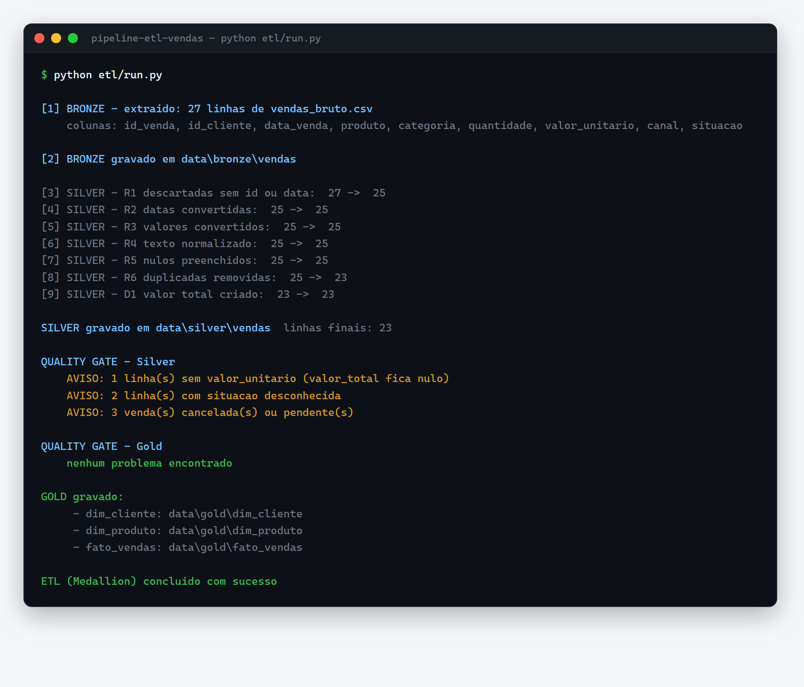
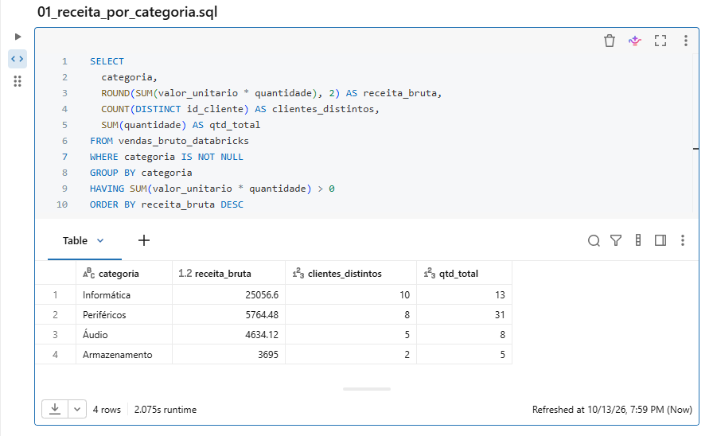
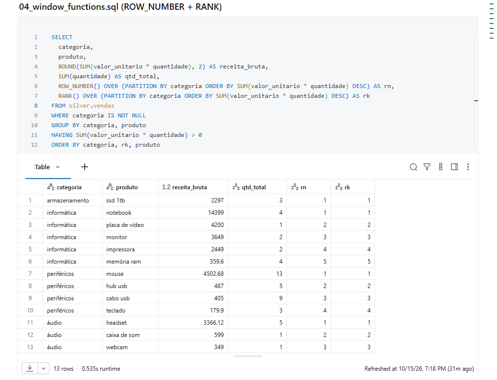
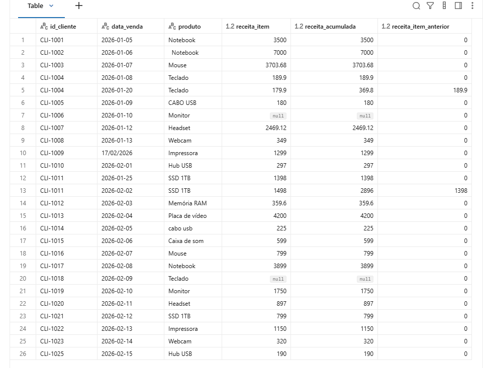
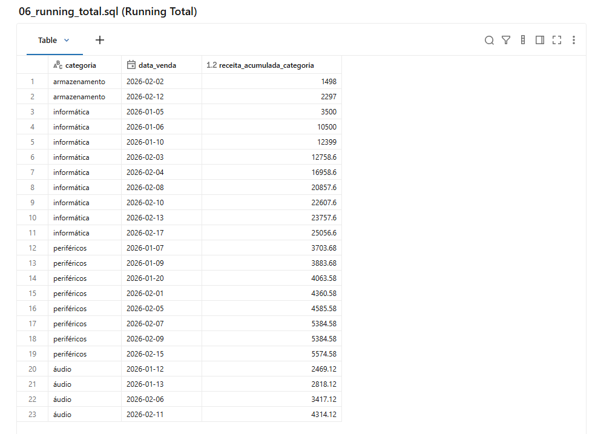
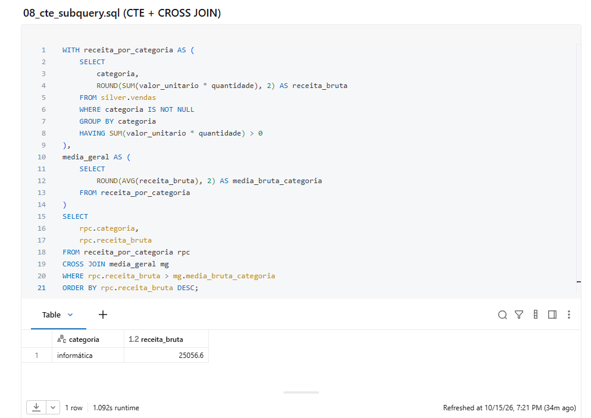
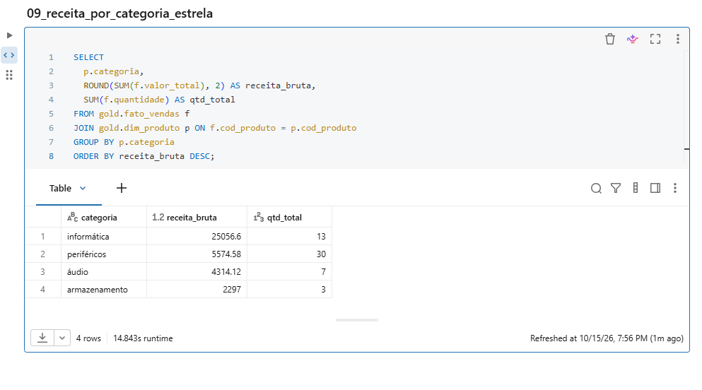
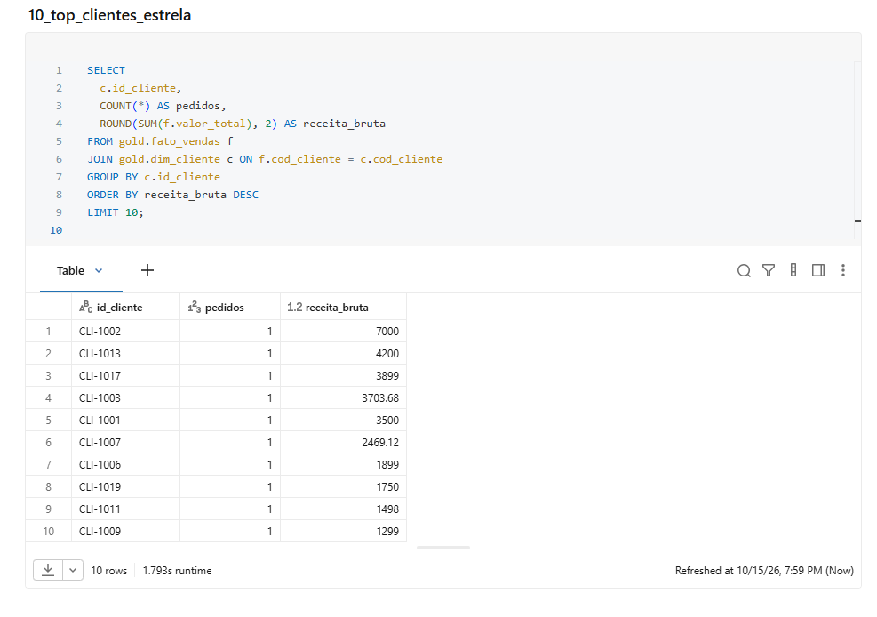

# ETL de vendas: CSV --> Bronze --> Silver --> Gold (Medallion)

[](https://www.python.org/)
[](https://spark.apache.org/)
[](https://spark.apache.org/)
[](https://www.databricks.com/)
[](https://en.wikipedia.org/wiki/SQL)
[](https://parquet.apache.org/)
[](https://docs.pytest.org/)

## Arquitetura (Medallion)





Pipeline de dados em PySpark com arquitetura Medallion: lê um CSV sujo, grava a camada Bronze, limpa e transforma para a camada Silver e gera as dimensões + fato na camada Gold.

411 linhas de código (sem testes), 11 testes, roda em cerca de 15 segundos.

Os dados são sintéticos e estão versionados em `dados/vendas_bruto.csv`, com sujeira proposital para cada regra do pipeline ter um motivo de existir.

## Como rodar

Precisa de Python 3.9+ e Java 11+.

```bash
python -m venv .venv
.venv\Scripts\activate          # Windows
pip install -r requirements.txt

python etl/run.py               # o pipeline inteiro
python -m pytest tests -q       # os testes
```

Saída esperada:

```text
[1] BRONZE - extraido: 27 linhas de vendas_bruto.csv
    colunas: id_venda, id_cliente, data_venda, produto, categoria, quantidade, valor_unitario, canal, situacao

[2] BRONZE gravado em data\bronze\vendas

[3] SILVER - R1 descartadas sem id ou data:  27 ->  25
[4] SILVER - R2 datas convertidas:  25 ->  25
[5] SILVER - R3 valores convertidos:  25 ->  25
[6] SILVER - R4 texto normalizado:  25 ->  25
[7] SILVER - R5 nulos preenchidos:  25 ->  25
[8] SILVER - R6 duplicadas removidas:  25 ->  23
[9] SILVER - D1 valor total criado:  23 ->  23
    ATENCAO: 1 venda(s) sem valor_unitario; valor_total fica nulo

SILVER gravado em data\silver\vendas
    linhas finais: 23

GOLD gravado:
     - dim_cliente: data\gold\dim_cliente
     - dim_produto: data\gold\dim_produto
     - fato_vendas: data\gold\fato_vendas

ETL (Medallion) concluido com sucesso
```

## O que acontece

```
dados/vendas_bruto.csv
        │
        ▼
   ┌─────────┐   lê o CSV como texto, sem corrigir nada
   │ extract │   (schema declarado, tudo como string)
   └────┬────┘
        ▼
  data/bronze/vendas   ← Parquet como o dado chegou (Bronze)
        │
        ▼
   ┌───────────┐  6 regras, uma função cada
   │ transform │  descartar, datas, valores, texto, nulos, duplicadas
   └─────┬─────┘  + 1 campo derivado (valor_total)
         ▼
  data/silver/vendas   ← Parquet limpo, tipado, sem duplicata (Silver)
         │
         ▼
   ┌───────────┐  star schema: 2 dimensões + 1 fato
   │   gold    │  dim_cliente, dim_produto, fato_vendas
   └─────┬─────┘
         ▼
  data/gold/*          ← Parquet pronto para análise/SQL (Gold)
```

O Bronze é gravado antes de limpar, de propósito: dá para conferir o que mudou comparando com o Silver, e o dado original não se perde.

## A sujeira do CSV e a regra que existe por causa dela

| O que tem no CSV | Regra | O que faz |
|------------------|-------|-----------|
| `189,90` e `R$ 1.234,56` | R3 converter valores | tira o `R$`, remove o ponto de milhar, troca a vírgula por ponto e vira `double` |
| `2026-01-05` e `17/02/2026` | R2 padronizar datas | as duas viram `date` |
| `  Notebook  `, `CABO USB`, `CANCELADO` | R4 normalizar texto | `trim` + `lower`, para o agrupamento não quebrar |
| `quantidade` e `situacao` vazias | R5 preencher nulos | quantidade vira 1; situação vira `desconhecida` |
| `VEN-0004` e `VEN-0011` aparecem 2 vezes | R6 remover duplicadas | `row_number` por `id_venda` ordenado por data, fica a mais recente |
| 1 linha sem `id_venda` e 1 sem `data_venda` | R1 descartar incompletos | sai do resultado e aparece na contagem do log |
| 1 linha sem preço | nenhuma | fica nulo de propósito, e o log avisa (ver abaixo) |
| campo vazio | nenhuma | o Spark lê como `null`, não como texto vazio |

Resultado: 27 linhas entram, 23 saem. Nenhum `id_venda` repetido, nenhuma data nula.

## Quatro bugs que só apareceram ao rodar

1. `189.90` virou `18990.0`. A primeira versão do CSV tinha valores em dois formatos e a regra
   tratava ponto como separador de milhar. O resultado estava 100× errado, porque o `count()`
   continuava 23. Corrigi padronizando a entrada em formato brasileiro: o número depende do sistema
   de origem.
2. A regra de situação vazia checava texto vazio (`""`), e o CSV entrega `null`. O teste montava o
   DataFrame com `""` e passava; o pipeline real deixava `situacao` nula. O teste virou parametrizado
   (`null` e `""`) e a regra passou a checar os dois.
3. `to_date` não aceita lista de formatos no PySpark 3.5 (`Method to_date([Column, ArrayList]) does
   not exist`). Resolvido com `when` escolhendo o formato antes de converter.
4. `Python worker failed to connect back` nos 7 testes. O worker do Spark sobe o `python` que estiver
   no PATH, e na minha máquina era um Python 3.14 sem o PySpark. Resolvido apontando `PYSPARK_PYTHON`
   para o mesmo interpretador do driver.

## Decisões que eu tomei, e o porquê

- Schema declarado com tudo como `string`. Se o Spark inferisse, `valor_unitario` viraria `string` numa linha e `double` na outra. Lendo tudo como texto, a conversão fica num só lugar.
- Nem todo nulo é preenchido. `quantidade` vazia vira 1. Preço vazio continua nulo, porque inventar um valor distorceria o faturamento. O log avisa, e a decisão fica com quem lê.
- Gravação com `overwrite`, o que torna a execução idempotente: rodar duas vezes não duplica linhas.
- Sem particionamento por data, porque 23 linhas não justificam isso. Serve para mostrar o conceito.
- `valor_total` é derivado, calculado a partir de `quantidade` e `valor_unitario`.

## Como esse código foi construído

O `etl/transform.py` foi reescrito à mão, regra por regra. Cada função (R1 a R6 + D1) cuida de uma coisa só, e `tratar()` junta tudo na ordem certa.

O objetivo foi entender o problema antes de escrever a solução. Por isso, `quantidade` vazia virou 1, mas `valor_unitario` vazio continua nulo. E para duplicados, ficou só a venda mais recente por `id_venda`.

O importante não é só o resultado (27 → 25 → 23), mas deixar cada decisão clara no código.

## Arquivos

| Arquivo | Linhas | O que é |
|---------|--------|---------|
| `etl/extract.py` | 40 | lê o CSV, com schema declarado |
| `etl/transform.py` | 61 | as 6 regras + o campo derivado |
| `etl/load.py` | 19 | grava Parquet |
| `etl/gold.py` | 73 | dimensões + fato (star schema da camada Gold) |
| `etl/run.py` | 85 | executa o pipeline (Bronze → Silver → Gold) e mostra o efeito de cada regra |
| `etl/quality.py` | 133 | quality gate: valida o Silver e bloqueia o Gold se houver erro |
| `tests/test_transform.py` | 133 | 9 testes, um por regra e dois de borda |
| `tests/test_quality.py` | 70 | 2 testes do quality gate |

## Testes

```
11 passed
```

Cobrem: valor com moeda e vírgula, data em `dd/mm/aaaa`, texto com espaço e caixa alta, duplicada
mantendo a data mais recente, nulo como `null` e como `""`, campo derivado, linha sem id/data, e o
preço ausente continuar nulo, além do gate aprovar uma base válida e reprovar uma data inválida.

No Windows, se aparecer `Python worker failed to connect back`, é o motivo do `PYSPARK_PYTHON` explicado
acima. Se faltar o `winutils.exe`, o PySpark no Windows precisa do Hadoop: aponte `HADOOP_HOME` para uma
pasta que contenha `bin\winutils.exe`.

## Quality gate

Antes de gravar o Gold, o `etl/quality.py` valida o Silver e bloqueia a publicação se encontrar erro:
`id_venda` vazio ou duplicado, `data_venda` nula/inválida, cliente/produto/categoria ausente,
`quantidade <= 0` ou preço negativo. No Gold, confere a contagem do fato contra o Silver e se
`cod_cliente`/`cod_produto` ficaram nulos.

O que apenas avisa: preço ausente (o `valor_total` fica nulo), situação `desconhecida` e vendas
canceladas/pendentes. Se houver erro, o pipeline sai com código 1 e não grava o Gold; Bronze e Silver
ficam no disco para diagnóstico.

## O que não tem aqui

Não tem orquestração (Airflow), particionamento, Delta Lake, Kubernetes, nem carga em warehouse.

Se subir um degrau, a ordem seria: particionamento por data → DAG no Airflow → escrita em Delta.

## SQL prático (Databricks CE)

Foram desenvolvidas e validadas no [Databricks Community Edition](https://community.cloud.databricks.com/) 10 queries SQL aplicadas aos dados reais do projeto, cobrindo agregações, JOIN, GROUP BY, HAVING, Window Functions (ROW_NUMBER, RANK, LAG, SUM() OVER), Esquema Estrela (2 dimensões + 1 fato), JOIN no modelo estrela e CTEs + Subqueries.

As queries leem as tabelas criadas a partir do Parquet do ETL: `silver.vendas` (camada limpa, tipada) para as queries 01-06 e 08, e as tabelas do modelo estrela (Gold) nas queries 07 (definição das dimensões e do fato), 09 e 10 (consulta com JOIN entre fato e dimensão). As 09 e 10 devolvem o mesmo resultado das 01 e 03, então servem de reconciliação entre Gold e Silver. O passo a passo de carga está em [DATABRICKS.md](DATABRICKS.md).

Os arquivos estão em [sql/](sql/).

| Query | Arquivo | Objetivo |
|---|---|---|
| 01 | [01_receita_por_categoria.sql](sql/01_receita_por_categoria.sql) | Receita total e quantidade vendida por categoria, com filtro por grupos (HAVING). |
| 02 | [02_vendas_por_canal_e_mes.sql](sql/02_vendas_por_canal_e_mes.sql) | Vendas por canal e mês (YEAR/MONTH), com agregações. |
| 03 | [03_top_clientes_por_receita.sql](sql/03_top_clientes_por_receita.sql) | Top clientes por receita, ticket médio com NULLIF, ordenação e filtro com HAVING. |
| 04 | [04_window_functions.sql](sql/04_window_functions.sql) | ROW_NUMBER() e RANK() com PARTITION BY para ranqueamento por categoria. |
| 05 | [05_acumulado_lag.sql](sql/05_acumulado_lag.sql) | SUM() OVER (running total por cliente) e LAG() para comparar com venda anterior. |
| 06 | [06_running_total.sql](sql/06_running_total.sql) | Running total por categoria ao longo do tempo (SUM(SUM(...)) OVER (...)). |
| 07 | [07_esquema_estrela.sql](sql/07_esquema_estrela.sql) | Criação do modelo estrela: dim_cliente, dim_produto (2 dimensões) e fato_vendas (1 fato). |
| 08 | [08_cte_subquery.sql](sql/08_cte_subquery.sql) | CTEs encadeados + CROSS JOIN para comparar receita média por categoria. |
| 09 | [09_receita_por_categoria_estrela.sql](sql/09_receita_por_categoria_estrela.sql) | Receita por categoria consultando o modelo estrela (JOIN fato + dim_produto); reconcilia com a 01. |
| 10 | [10_top_clientes_estrela.sql](sql/10_top_clientes_estrela.sql) | Top clientes por receita via modelo estrela (JOIN fato + dim_cliente); reconcilia com a 03. |

### Validações no Databricks CE

| Query | Print |
|---|---|
| 01 |  |
| 04 |  |
| 05 |  |
| 06 |  |
| 08 |  |
| 09 |  |
| 10 |  |

> Base: Parquet gerado pelo ETL (`data/silver/vendas` e `data/gold/*`), carregado como tabelas no Databricks.
